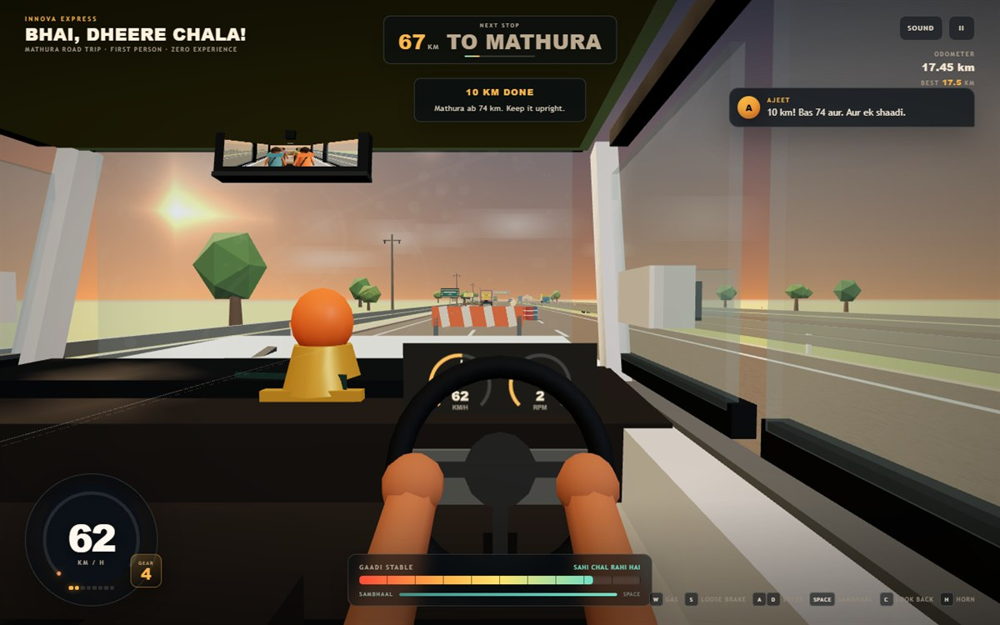

# Bhai, Dheere Chala!

**Five friends. One shaky 7-seater Innova. 84 km to Mathura.**

You are Sahil, and this is your first proper highway drive. Ajeet and Saurabh are in the middle row giving unsolicited advice, while Shubham and Abhishek are asleep in the last row. The brakes are loose, the clutch has opinions, and the Innova has the structural confidence of a tall cardboard box.

Keep the shiny side up for as long as you can.

### ▶ [Play in your browser](https://ajeet-iitk.github.io/MathuraTrip1/)

No install, no build step, no login.



## The trip

- **A proper first-person cabin** — steering wheel, dashboard idol, rear-view mirror, and all four friends visible when you look back.
- **An intentionally nervous Innova** — loose brakes, a laggy clutch, body roll, crosswinds, and a stability meter that gives up if you drive it like a hero.
- **A road full of bad news** — traffic, oncoming lorries, potholes, speed breakers, barricades, oil drums, cement blocks, and the occasional fallen sabzi thela.
- **Hard steering tips you over** — hold a sharp turn above ~56 km/h and the warning appears. Ignore it for about two seconds and you are horizontal.
- **A full topple sequence** — chase camera, dust, crash dialogue, and five friends who suddenly remember they were awake the whole time.
- **Touch controls** for phones and tablets.
- **Personal best** saved in your browser.

> “Abhi to meri shadi bhi nhi hui!” — Ajeet  
> “Kya hua tha bhai, hum to so rhe the.” — Shubham & Abhishek

## Controls

| Action | Keyboard | Touch |
| --- | --- | --- |
| Accelerate | `W` / `↑` | **GAS** |
| Brake (eventually) | `S` / `↓` | **BRAKE** |
| Steer | `A` `D` / `←` `→` | ◀ ▶ |
| Sambhaal (grip the wheel) | `Space` | **SAMBHAAL** |
| Look back at the boys | `C` | — |
| Horn | `H` | — |
| Pause | `P` | `II` |
| Mute | `M` | **SOUND** |

## Run it locally

The game is a static site with no dependencies to install.

```bash
git clone https://github.com/Ajeet-iitk/MathuraTrip1.git
cd MathuraTrip1
```

Then either double-click `index.html`, or serve the folder:

```bash
python -m http.server 8080
```

Open `http://localhost:8080/`.

## Tech

- Plain HTML, CSS, and JavaScript
- [Three.js](https://threejs.org/) r152.2, bundled locally so the game works offline
- Procedural low-poly models, textures, and Web Audio sounds — no external art or audio assets
- Hosted for free on GitHub Pages

## Notes

- Sound starts after your first click or tap, as required by browser autoplay rules.
- Best played on desktop, but the touch layout is designed for phones.
- The game is meant to be a comedy. Please drive better than Sahil in real life.

## Credits

Three.js is copyright 2010–2023 Three.js Authors and is used under the MIT license. See [THIRD_PARTY_NOTICES.md](THIRD_PARTY_NOTICES.md).

Everything else — code, models, textures, and sounds — was made for this project.
